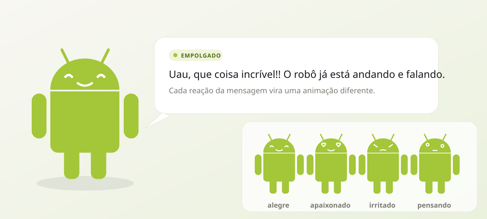

# Robô Android Reativo

Extensão Chrome (Manifest V3) que transforma a mensagem do assistente em **gesto**: o Robô Android
lê a última mensagem da página, sente a **reação** que ela carrega e anda pela tela **falando** —
com a mensagem transcrita em um balão de fala.



## O que ela faz

| Comportamento | Detalhe |
|---|---|
| **Lê a mensagem** | Observa o DOM e captura o texto do assistente (com streaming: espera o texto parar) |
| **Acha o chat sozinho** | 3 camadas de detecção — manual, marcador no DOM e descoberta estrutural |
| **Sente a reação** | Léxico PT-BR/EN + emoji + pontuação → 14 humores detectáveis |
| **Anima** | Cada humor tem uma animação de corpo, uma expressão facial e partículas |
| **Fala** | Balão com efeito de máquina de escrever (e voz opcional via Web Speech API) |
| **Anda** | Passeia pelo rodapé com ciclo de passos real (as pernas giram com a distância percorrida) |

Tudo roda localmente no navegador. Nenhum texto é enviado para fora.

## Reações reconhecidas

| Humor | Gatilhos típicos | Expressão | Animação |
|---|---|---|---|
| `comemorando` | "parabéns", 🎉, 🥳 | olhos de estrela | giro de 360° + confete |
| `alegre` | "obrigado", "perfeito", ✅ | olhos arqueados | quique |
| `empolgado` | "incrível", "uau", 🔥, 😄 | olhos de estrela | pulo |
| `apaixonado` | "amo", ❤️, 🥰 | corações | batida |
| `triste` | "decepcionado", 😢, 😞 | olhos caídos | desmancha |
| `irritado` | "odeio", 😡, "erro" | sobrancelhas | tremor + glitch de cor |
| `surpreso` | "inesperado", 😮, ❗ | olhos arregalados | estalo de escala |
| `pensando` | "talvez", "vou verificar", 🤔 | olho para cima | inclinação + "…" |
| `confuso` | "não sei", "???" | olhos tortos | bamboleio |
| `cansado` | "cansado", 😴 | olhos semicerrados | balanço lento |
| `assustado` | "perigo", 😱, ⚠️ | olhos arregalados | tremor |
| `orgulhoso` | "conquistei", "accomplished" | olhar para cima | peito estufado |
| `deu ruim` | "falhou", "não funcionou", 🛑 | sobrancelhas | glitch |
| `neutro` | qualquer outra coisa | olhos normais | aceno |

## Instalação

### A partir do clone

```bash
git clone https://github.com/xmyguel-x/robo-android-reativo.git
cd robo-android-reativo
python3 tools/restore_assets.py     # materializa os ícones PNG (ver nota abaixo)
```

Depois:

1. Abra `chrome://extensions` e ative o **Modo do desenvolvedor**.
2. Clique em **Carregar sem compactação** e selecione a pasta do projeto.
3. Abra o chat que você usa e recarregue a página (F5).

> No Chrome, o content script só roda em páginas `http(s)`. Se usar o app local em `file://`,
> habilite **Permitir acesso a URLs de arquivo** na página da extensão.

### Nota sobre os ícones

Os `icons/*.png` são versionados **em base64** — a API de push do GitHub só aceita texto, então os
binários não sobem íntegros por lá. O `tools/restore_assets.py` converte cada arquivo de base64
para PNG de verdade e liga o bloco `icons` do `manifest.json` (é idempotente). Se você baixou um
pacote com os ícones já prontos, esse passo não é necessário — a extensão carrega e funciona
mesmo sem ele, só fica com o ícone padrão do Chrome na barra.

## Apontar o robô para a sua mensagem

O robô **encontra o chat sozinho**. A detecção acontece em três camadas, nessa ordem:

1. **Manual** — se você já escolheu um elemento no popup, ele manda em tudo.
2. **Marcador no DOM** — quando a página marca o papel de cada mensagem
   (`data-role="assistant"`, `data-message-author-role`, `data-author`, `data-testid`,
   classes como `assistant`/`agent`/`bot`/`mcode`/`mavis`…).
3. **Estrutural** — quando não há marcador nenhum, a extensão **descobre a lista de mensagens
   sozinha**: acha os blocos repetidos (mesma tag + mesma classe, com texto), classifica cada um
   como *assistente*, *usuário* ou *desconhecido* e escolhe os do assistente. Os sinais usados,
   em ordem: atributos e classes → posição na tela (em chat LTR o usuário fica à direita) →
   alternância (em chat, as mensagens se alternam; a última resposta é a do assistente).

O popup mostra sempre qual camada está ativa (`Automático — marcador no DOM`,
`Automático — estrutura do chat`, `Manual`) e quantas mensagens foram lidas.

Se a sua página for muito exótica, aponte manualmente:

1. Abra o popup da extensão → **Selecionar mensagem na página**.
2. Clique no balão do assistente na página. O seletor CSS é salvo automaticamente.

E **Redetectar automaticamente** volta para a detecção por conta própria. Você também pode digitar
o seletor manualmente em **Opções → Leitura das mensagens**.

## Opções

* **Voz** — ativar leitura em voz alta, escolher a voz, velocidade e tom.
* **Aparência** — tamanho do robô, largura do balão, tempo até o balão sumir, etiqueta de humor.
* **Ajustes rápidos** no popup: robô ativo, andar, falar.

## Como funciona por dentro

```
src/content.js   mascote, motor de caminhada, detecção de reação, balão
src/robot.css    layout do balão, expressões, keyframes de cada reação
src/popup.*      atalhos rápidos + seleção do elemento na página
src/options.*    preferências completas
src/background.js  padrões de configuração na instalação
tools/           gerador da capa SVG e restauração dos ícones
```

O robô é um SVG articulado montado à mão: cabeça, antenas, corpo, braços e pernas são grupos
independentes. O ciclo de caminhada é calculado em `requestAnimationFrame` a partir da
**distância percorrida** (e não do tempo), então as pernas giram sempre na direção do movimento e
param quando o robô para.

## Testes

```bash
cd android-robot-extension
python3 -m http.server 8765 --bind 127.0.0.1 &
python3 test/test_extension.py
```

O teste carrega a extensão de verdade no Chromium, abre `test/mock-chat.html` e confere injeção
do mascote, leitura da mensagem, detecção de cada reação, expressão resultante e locomoção.

O mock aceita `?variant=` e reproduz cinco DOMs de chat diferentes — é o que prova a detecção
automática:

| Variante | DOM | Camada esperada |
|---|---|---|
| `role` | `data-role="assistant"` | marcador |
| `attribute` | `data-message-author-role="assistant"` | marcador |
| `class` | `class="message assistant"` | marcador |
| `aligned` | sem marcador, usuário à direita | estrutura |
| `plain` | sem marcador, sem alinhamento | estrutura |

As capturas ficam em `test/shots/`.

## Privacidade

A extensão não faz requisições de rede. Todo o processamento (leitura do DOM, detecção de humor,
animação e voz) acontece no navegador.

## Licença

MIT
